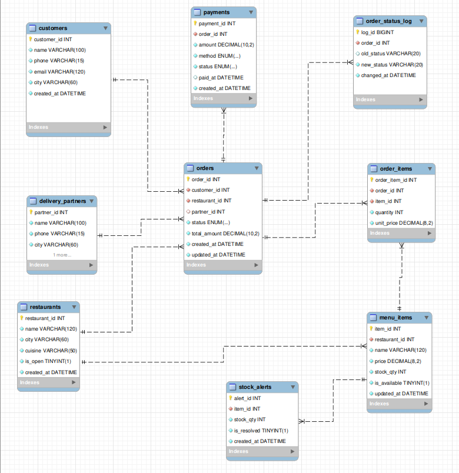

# 🍽️ Food Delivery Database Management System

## 1)💡 Project Overview
📌This project is a relational database system for a food delivery platform, built using MySQL. It models the core operations of a food delivery service, including customer management, restaurant management, menu items, order processing, payments, and delivery partner assignments.

📌The database is designed with nine interconnected tables, using primary keys, foreign keys, constraints, and relationships to maintain data integrity and consistency.

📌The project focuses on implementing practical SQL concepts and database-level operations to manage and automate food delivery workflows.

## 2)🗄️ Database Design

### 🛢️ Entity Relationship Diagram (ERD)
The database consists of nine interconnected tables representing the core entities of a food delivery platform. The ERD illustrates the relationships between customers, restaurants, orders, menu items, payments, and delivery partners.

### 🗂️ Database Schema
The database consists of nine tables, each serving a specific purpose in managing the food delivery workflow.

| Table Name | Description |
|---|---|
| CUSTOMERS | Stores customer details and contact information. |
| RESTAURANTS | Stores restaurant details, cuisine, and availability. |
| MENU_ITEMS | Maintains restaurant menu items, prices, and stock quantities. |
| DELIVERY_PARTNERS | Stores delivery partner details and status. |
| ORDERS | Records customer orders, restaurant details, delivery assignments, and order status. |
| ORDER_ITEMS | Stores the individual menu items included in each order. |
| PAYMENTS | Maintains payment amounts, methods, and payment status. |
| ORDER_STATUS_LOG | Tracks changes in order status for auditing. |
| STOCK_ALERTS | Records stock alerts for menu items. |

### 🔐 Database Constraints & Indexing

The database uses various constraints and indexes to maintain data integrity and improve query performance.

**Constraints:**
- Primary Keys to uniquely identify records.
- Foreign Keys to maintain relationships between tables.
- UNIQUE constraints to prevent duplicate customer emails, phone numbers, and restaurant menu entries.
- CHECK constraints to validate prices, stock quantities, order totals, and payment amounts.
- ENUM data types to restrict order status, payment method, payment status, and delivery partner status to predefined values.
- NOT NULL constraints to ensure required fields contain values.

**Indexes:**
- Indexes are created on frequently queried columns such as customer city, order status, and payment status, and on restaurant cuisine as part of a composite index. Composite indexes are used to support filtering and sorting operations, for example (customer_id, created_at), (restaurant_id, created_at), (status, created_at) on orders, and (status, paid_at) on payments.

### 🧬 Sample Data Generation

The database is populated with synthetic data generated by a Python script (`scripts/generate_data.py`) using the Faker library and the MySQL connector.

- Generates 2,000 customers, 200 restaurants, 2,112 menu items, 150 delivery partners, 30,000 orders, 75,061 order items and 30,000 payments, along with about 143,000 order status history records.
- Customers order only from restaurants in their own city, across 8 cities and 6 cuisines. Orders are spread over the last year, with more orders at lunch and dinner hours.
- About 92% of finished orders are delivered and 8% are cancelled. The newest 150 orders are left in progress, so the stored procedures can be tested on live orders.
- A few menu items start with zero or very low stock, to test the low-stock trigger and out-of-stock errors.
- Order totals, payment statuses and order histories are generated consistently, and each order line stores the menu price at the time of ordering.
- A fixed random seed makes the data reproducible, and the script clears the tables before loading, so it can be re-run safely.
- The script is run before the triggers are created, so the historical data loads without firing them.
- All data is synthetic. No real customer data is used.
## 3)⚙️ SQL Features
### 📜 Stored Procedures

- `place_order` – Places orders, validates carts, updates stock, and processes payments.
- `cancel_order` – Cancels eligible orders, restores stock, and updates payment status.
- `assign_delivery_partner` – Assigns available delivery partners based on customer city.
- `update_order_status` – Enforces valid order status transitions.
- `monthly_revenue_report` – Generates monthly revenue analytics using window functions.
- `search_orders` – Supports dynamic order filtering and sorting with a result limit, using a prepared statement.
### 🔔 Triggers

- `trg_order_status_log` – Tracks order status changes for auditing.
- `trg_low_stock_alert` – Generates low-stock alerts and resolves them when stock is replenished.
- `trg_block_unavailable_item` – Prevents unavailable items and items from other restaurants from being added to an order.

### 🔒 Prepared Statements

- Used parameterized queries to execute dynamic SQL safely.
- Tested parameter binding against SQL injection attempts.

## 4)🧪 Testing

The project includes SQL test scripts to validate stored procedures, triggers, error handling, and prepared statements. Tests cover successful operations, invalid inputs, failure scenarios, and data integrity.

## 5)🎥 Demo Videos

All project demonstrations, including database setup, stored procedures, triggers, prepared statements, and testing, are available here:

[🎬Watch Project Demo Videos](https://drive.google.com/drive/folders/1PfLU7DJodHqhh0QSQE88SHGKCtA4bppj?usp=drive_link)